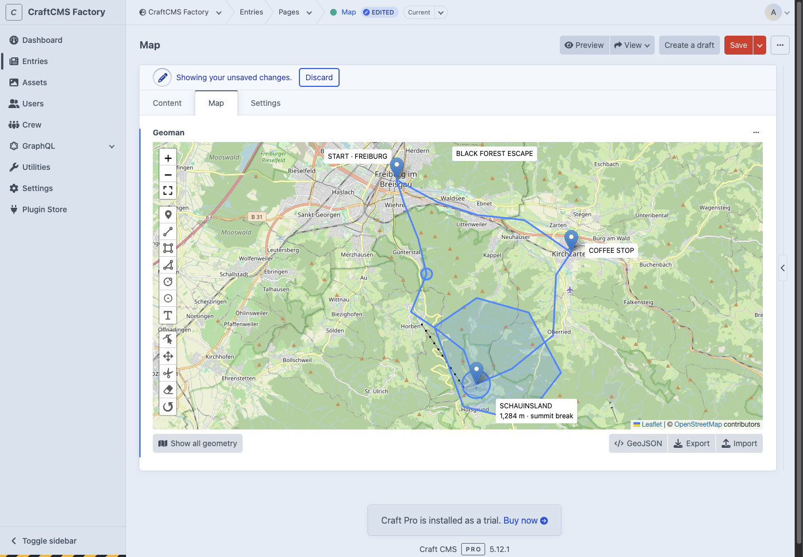
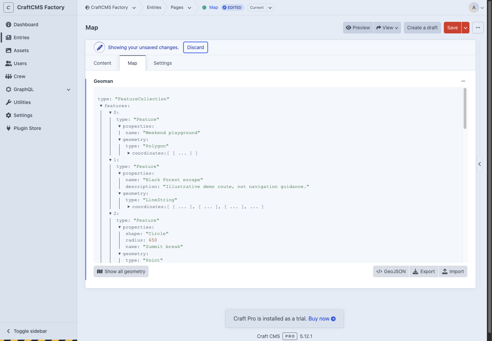
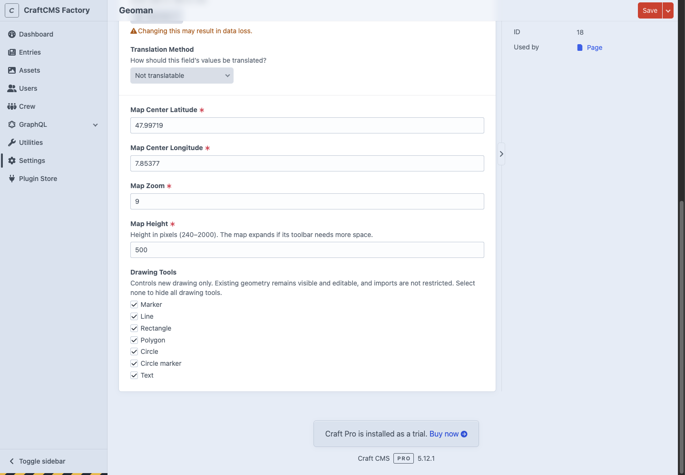

# Craft Geoman

A geometry field for Craft CMS 5, powered by Leaflet and Leaflet-Geoman Free. Draw and edit maps, import/export GeoJSON, and add text annotations.

## Installation

Requires Craft CMS **5.0+ (5.x)** and PHP **8.2+**.

Run `composer require handplant/craft-geoman`, then install Craft Geoman under **Settings → Plugins**.

Updating an existing installation? Read the [upgrade notes](docs/UPGRADING.md) first. For Craft 4, use plugin 1.x on the `craft-cms-4` branch.

## Usage

- Create a **Geoman** field and add it to a field layout.
- Draw markers, lines, rectangles, polygons, circles, circle markers, or text.
- Use **Show all geometry** to fit the map, **GeoJSON** to inspect the value, and **Export / Import** to exchange files.

## Settings

Configure each field's map center, zoom, height, and available drawing tools.

- **Map height:** 500px by default; configurable from 240–2000px. The map expands if the toolbar needs more room.
- **Drawing tools:** the original six tools are enabled by default; **Text** is opt-in. Disabling a tool does not hide existing geometry or restrict imports.
- **Editing tools:** Cut and Rotate appear when the drawing selection or existing geometry supports them. Edit, Move, and Delete remain available on editable maps.

## Good to know

The field returns a **GeoJSON string**. It does not automatically render a map on your website; see the [frontend example](docs/FRONTEND.md).

Scripts and styles are bundled locally; no Geoman Pro subscription is required. Basemap tiles come from OpenStreetMap and require internet access. Its [tile usage policy](https://operations.osmfoundation.org/policies/tiles/) applies.

[Changelog](CHANGELOG.md) · [Report an issue](https://github.com/handplant/craft-geoman/issues)
